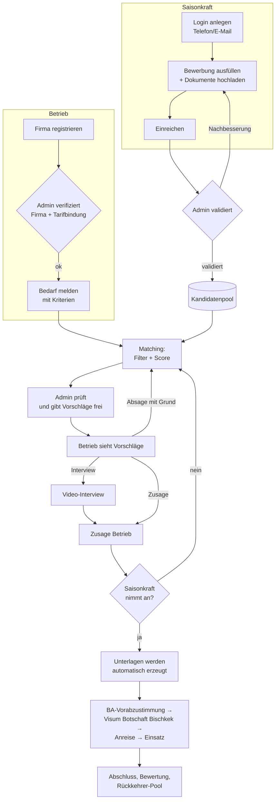
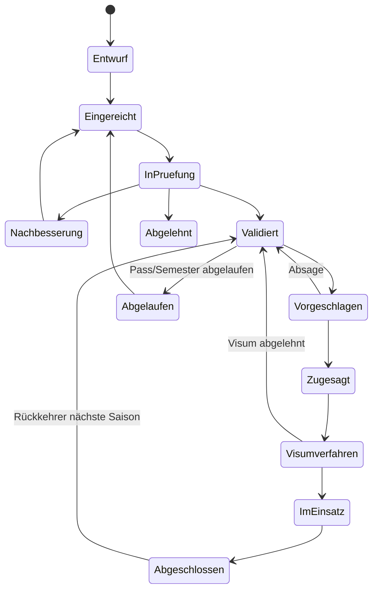

# Konzept: Vermittlungsplattform für Saisonkräfte aus Kirgisistan

Stand: 10.11.2026 · Status: Entwurf zur Abstimmung

---

## 1. Kurzfassung

- Eine Web-Plattform bringt deutsche Betriebe mit saisonalem Personalbedarf
  (Freizeitanlagen, Gastronomie, Hotel, Landwirtschaft) mit geprüften
  Saisonkräften aus Kirgisistan zusammen.
- **Betriebe** registrieren ihre Firma, melden einen Bedarf mit Kriterien,
  bekommen Vorschläge, geben Rückmeldung. Sobald Betrieb und Saisonkraft
  zugesagt haben, erzeugt das System die Unterlagen automatisch.
- **Saisonkräfte** legen über einen eigenen Login ihre Bewerbung an
  (Russisch/Kirgisisch, fürs Handy gebaut). Ein **Admin** prüft und
  validiert jede Bewerbung. Erst validierte Profile werden vorgeschlagen.
- **Rechtlicher Hauptweg** ist die *kurzzeitige kontingentierte Beschäftigung*
  (§ 19c Abs. 1 AufenthG i. V. m. § 15d BeschV). Er steht jeder Branche offen,
  setzt aber einen **tarifgebundenen** Arbeitgeber voraus. Der Weg über die
  Landwirtschafts-Saisonbeschäftigung (§ 15a BeschV) ist für Kirgisistan
  derzeit **nicht** offen.
- Die Plattform **vermittelt nur**. Der Arbeitsvertrag entsteht direkt zwischen
  Betrieb und Saisonkraft, denn Leiharbeit ist für diesen Weg ausgeschlossen.
  Saisonkräfte zahlen nichts, die Betriebe zahlen die Gebühr.
- **Domains:** `saisonbruecke.de` und `saisonbruecke.com` sind frei, ebenso
  `jumush.de` (kirgisisch *жумуш* = Arbeit) und
  `saisonkraefte-kirgisistan.de` (Abschnitt 12).
- **Zeitplan:** Für die Saison 2027 muss das MVP bis Ende Januar 2027 laufen.
  Vom Bedarf bis zur Anreise sind etwa 3–4 Monate zu rechnen.

---

## 2. Rechtlicher Rahmen

> Alles in diesem Abschnitt vor dem Start von einer Fachanwältin oder einem
> Fachanwalt für Migrationsrecht prüfen lassen. Kontingent, Formulare und
> Länderlisten ändern sich, maßgeblich sind die aktuellen Seiten der
> Bundesagentur für Arbeit (BA) und der Deutschen Botschaft Bischkek.

### 2.1 Mögliche Wege nach Deutschland

| Weg | Grundlage | Für wen | Dauer | Wesentliche Bedingungen | Rolle der Plattform |
| --- | --- | --- | --- | --- | --- |
| **Kurzzeitige kontingentierte Beschäftigung** (Hauptweg) | § 19c Abs. 1 AufenthG i. V. m. § 15d BeschV | Alle Branchen, keine Qualifikation nötig | max. 90 Tage je 180 Tage bzw. **8 Monate je 12 Monate** | Arbeitgeber **tarifgebunden**, regelmäßig **≥ 30 Std./Woche**, sozialversicherungspflichtig, tarifliche Bezahlung, **Arbeitgeber trägt die Reisekosten**, Kontingent der BA (zuletzt **25.000** Zustimmungen pro Jahr, jederzeit anpassbar), **Vorabzustimmung** der BA vor dem Visum (online beantragbar) | Matching, Unterlagen inkl. vorbefüllter *Erklärung zum Beschäftigungsverhältnis* + *Zusatzblatt D*, Fristen-Tracking |
| **Ferienbeschäftigung Studierender** (Nebenweg) | § 14 Abs. 2 BeschV | Studierende an ausländischen Hochschulen, laut ZAV-Merkblatt unter 35 | max. 90 Tage in 12 Monaten, nur in den Semesterferien | Vermittlung **zwingend durch die ZAV** der BA. Der Betrieb darf Studierende **namentlich anfordern**. Angebote frühestens ab April | Vorauswahl und Matching, Unterlagen für die namentliche Anforderung bei der ZAV. Gebührenmodell hier gesondert klären |
| Saisonbeschäftigung Landwirtschaft | § 15a BeschV | Nur Staaten mit Vermittlungsabsprache der BA (derzeit Georgien, Moldau) | 90 Tage je 180 Tage | – | **Für Kirgisistan aktuell nicht möglich.** Beobachten: Absichtserklärung zum Migrationsabkommen DE–KG (09/2023), Abkommen laut BMI in Vorbereitung |

Konsequenz für das Produkt: Bei der Firmenregistrierung wird die
**Tarifbindung** abgefragt und belegt. Ohne Tarifbindung kann der Betrieb nur
über den Studierenden-Weg Kräfte bekommen, und das zeigt die Plattform schon
beim Anlegen des Bedarfs an.

### 2.2 Harte Grenzen für das Geschäftsmodell

1. **Keine Arbeitnehmerüberlassung.** Die BA versagt ihre Zustimmung, wenn die
   Kraft als Leiharbeitnehmer arbeiten soll (§ 40 Abs. 1 Nr. 2 AufenthG). Die
   Plattform ist deshalb reine **Vermittlerin**. Arbeitgeber ist immer der
   Einsatzbetrieb.
2. **Keine Gebühren für Saisonkräfte** (Arbeitgeber zahlt, wie im
   ILO-Übereinkommen 181 vorgesehen). § 296 SGB III begrenzt die Vergütung, die
   von Arbeitsuchenden verlangt werden darf, ohnehin. Gebühren auf
   kirgisischer Seite schließt der Vertrag mit der Partneragentur aus.
3. **Lizenzpflicht in Kirgisistan.** Wer Bürgerinnen und Bürger Kirgisistans
   ins Ausland vermittelt, braucht eine Lizenz des Arbeitsministeriums
   (Center for Employment of Citizens Abroad, Liste auf `migrant.kg`).
   Vorgeschrieben ist außerdem eine Vorbereitung vor der Ausreise. Daraus folgt:
   Kooperation mit einer **lizenzierten Agentur in Bischkek** oder eine
   eigene Lizenz.
4. **Schriftform bei Befristung.** Eine Befristung im Arbeitsvertrag braucht
   Schriftform (§ 14 Abs. 4 TzBfG). Generierte Verträge werden also
   **im Original unterschrieben** oder mit **qualifizierter elektronischer
   Signatur** (QES). Eine einfache E-Signatur reicht nicht.
5. **AGG.** Bedarfskriterien müssen sich auf die Tätigkeit beziehen. Filter nach
   Geschlecht, Herkunft, Religion oder Familienstand sind nicht erlaubt. Alter nur, wo
   es rechtlich zählt (volljährig; unter 35 beim Studierenden-Weg). Fotos sind
   optional und werden beim Matching nicht berücksichtigt.
6. **DSGVO.** Passdaten und Dokumente sind sensibel. Hosting in der EU,
   Einwilligung **pro Vorschlag** in die Weitergabe an den konkreten Betrieb,
   Löschfristen, Auftragsverarbeitungsvertrag mit der Partneragentur. Keine
   Gesundheitsdaten erheben.
7. **Gewerbe.** Private Arbeitsvermittlung ist in Deutschland nicht
   erlaubnispflichtig, braucht aber eine Gewerbeanmeldung.

---

## 3. Rollen

| Rolle | Wer | Darf |
| --- | --- | --- |
| **Betrieb** (Inhaber + weitere Nutzer) | Arbeitgeber in Deutschland | Firma pflegen, Bedarfe melden, Vorschläge sehen, Rückmeldung geben, Unterlagen abrufen, Status verfolgen |
| **Saisonkraft** | Bewerberin/Bewerber in Kirgisistan | Eigene Bewerbung anlegen und einreichen, Angebote annehmen/ablehnen, eigene Dokumente und Checklisten sehen |
| **Admin** | Betreiber der Plattform | Firmen verifizieren, Bewerbungen validieren, Vorschläge freigeben, Vorlagen pflegen, alles sehen |
| **Partneragentur** (Phase 2) | Lizenzierte Agentur in Bischkek | Kandidaten anlegen/vorprüfen, Interviews auf Russisch/Kirgisisch, Ausreisevorbereitung bestätigen. Sieht nur eigene Kandidaten |

---

## 4. Gesamtablauf

---

## 5. Funktionen im Detail

### 5.1 Firma registrieren

- Registrierung mit E-Mail + Passwort, E-Mail-Bestätigung. 2FA (TOTP) optional.
- Firmendaten: Name, Rechtsform, Anschrift, Handelsregister/Gewerbe,
  USt-ID, Branche, Einsatzort(e), Ansprechpartner.
- **Tarifbindung:** ja/nein, Tarifvertrag, Nachweis-Upload (z. B.
  Verbandsmitgliedschaft). Entscheidet, welcher Rechtsweg offensteht.
- Unterkunft: Kann der Betrieb Unterkunft stellen? Wenn ja: Adresse, Plätze,
  Kosten pro Monat, Fotos.
- Admin verifiziert die Firma (Register-Abgleich, Telefonat). Ohne Prüfung kein
  Zugang zu Kandidatendaten.

### 5.2 Bedarf melden (mit Kriterien)

Ein Assistent in vier Schritten: **Stelle → Zeitraum & Konditionen →
Anforderungen → Prüfung**. Am Ende zeigt er den passenden Rechtsweg und
die späteste Meldefrist an.

| Feld | Typ | Matching |
| --- | --- | --- |
| Tätigkeit (Service, Küche, Housekeeping, Kasse/Empfang, Anlagenbetrieb, Ernte, Gartenbau, Reinigung, Sonstiges + Freitext) | Auswahl | Pflicht |
| Anzahl Kräfte | Zahl | – |
| Einsatz von–bis, Mindestdauer | Datum | Pflicht (Verfügbarkeit muss abdecken) |
| Wochenstunden | Zahl (≥ 30 beim Hauptweg) | Pflicht |
| Bruttolohn €/Std. + Tarifvertrag | Zahl/Text | Info für Kandidat, Plausibilitätsprüfung |
| Unterkunft gestellt / Kosten | ja/nein, € | Info, Präferenz der Kandidaten |
| Deutschkenntnisse min. (keine, A1, A2, B1, B2) | Stufe | Muss oder Wunsch |
| Englisch / Russisch | Stufe | Muss oder Wunsch |
| Erfahrung in der Tätigkeit (Monate) | Zahl | Muss oder Wunsch |
| Führerschein (B, C, Stapler) | Mehrfachauswahl | Muss oder Wunsch |
| Nachweise (Rettungsschwimmer, Erste Hilfe, Koch-Ausbildung) | Mehrfachauswahl | Muss oder Wunsch |
| Arbeitsbedingungen (Schicht, Wochenende, körperlich schwer, draußen) | Checkboxen | Kandidat bestätigt Bereitschaft |
| Rückkehrer bevorzugt | ja/nein | Bonus im Score |
| Rechtsweg | automatisch, überschreibbar durch Admin | Filter (z. B. nur Studierende) |

Jedes Anforderungsfeld lässt sich als **Muss** (harter Filter) oder **Wunsch**
(geht in den Score ein) markieren.

### 5.3 Vorschläge und Rückmeldung

- Der Betrieb sieht pro Bedarf eine Liste von Profilkarten: Vorname,
  Altersgruppe, Sprachniveaus, Erfahrung, Verfügbarkeit, Rückkehrer-Badge,
  „Warum passt das?“-Erklärung aus dem Score, optional ein kurzes
  Vorstellungsvideo. Nachname und Kontaktdaten erst nach beidseitiger Zusage.
- Aktionen pro Vorschlag:
  - **Zusage**
  - **Interview anfragen**: Terminvorschläge, Video-Link, bei Bedarf mit
    Dolmetscher der Partneragentur
  - **Absage mit Grund**: Sprache / Erfahrung / Zeitraum / Sonstiges + Freitext.
    Der Grund fließt ins Matching zurück
  - **Parken**
- Die Saisonkraft bekommt die Zusage als Angebot mit allen Konditionen
  (Ort, Zeitraum, Lohn, Unterkunft, Reisekosten) in ihrer Sprache und nimmt an
  oder lehnt ab. Erst nach der Annahme werden die Unterlagen erzeugt.
- Frist: Vorschläge laufen nach z. B. 7 Tagen ab, damit Kandidaten nicht
  blockiert bleiben. Ein Kandidat kann höchstens einem Betrieb fest zugesagt
  sein.

### 5.4 Saisonkraft-Login und Bewerbung

- **Sprachen:** Russisch, Kirgisisch, Deutsch, Englisch. Mobile first, weil
  die meisten Bewerbungen vom Handy kommen.
- **Login** per Telefonnummer oder E-Mail mit Einmalcode. Benachrichtigungen
  zusätzlich über Telegram/WhatsApp, die in Kirgisistan stärker genutzt werden
  als E-Mail.
- **Bewerbungs-Assistent** (Zwischenstände werden gespeichert, Fortschrittsbalken):
  1. Persönliche Daten (wie im Pass), Kontakt, Wohnort
  2. Reisepass: Nummer, gültig bis, Scan. Hinweis, wenn er vor Einsatzende
     + 3 Monate abläuft
  3. Sprachen mit Selbsteinschätzung + Zertifikat-Upload (z. B. Goethe A1/A2)
  4. Ausbildung/Studium. Für den Studierenden-Weg: Hochschule, Vollzeit,
     Immatrikulationsbescheinigung, Semesterferien
  5. Berufserfahrung (Tätigkeit, Land, Dauer, Referenz-Kontakt)
  6. Führerschein, Nachweise
  7. Verfügbarkeit (Zeiträume), Wunsch-Tätigkeiten, Bereitschaft (Schicht,
     Wochenende …)
  8. Frühere Aufenthalte in Deutschland/Schengen (Visa-Historie)
  9. Optional: Foto, 60-Sekunden-Vorstellungsvideo
  10. Einwilligungen (Datenschutz, Weitergabe pro Vorschlag), Absenden
- Nach dem Absenden ist die Bewerbung gesperrt, bis der Admin sie prüft. Der
  Admin kann einzelne Felder mit Kommentar zur **Nachbesserung**
  zurückgeben.
- Der Kandidat sieht seinen Status, Angebote, generierte Dokumente und eine
  persönliche **Checkliste** (Visa-Termin, Unterlagen, Flug, Ankunft).
- Aus den Daten entsteht automatisch ein **deutscher Lebenslauf**, den der
  Kandidat vor dem Absenden ansehen kann.

### 5.5 Admin-Bereich

- **Validierungs-Queue** mit fester Checkliste pro Bewerbung:
  - Identität: Daten = Pass, Pass gültig lange genug
  - Sprachniveau verifiziert (Zertifikat oder Kurztest im Video-Call)
  - Studierendenstatus (nur Studierenden-Weg), aktuell und Vollzeit
  - Erfahrung plausibel (Stichprobe Referenz)
  - Ausreisevorbereitung in Kirgisistan absolviert (Partneragentur)
  - Ergebnis: **validiert** / **Nachbesserung** / **abgelehnt** (mit Grund).
    Die Validierung läuft ab (Pass, Semester) und wird dann neu fällig.
- **Firmen-Verifizierung** (Register, Tarifbindung, Unterkunft)
- **Matching-Cockpit**: Pro Bedarf die Score-Rangliste. Der Admin wählt aus,
  ergänzt einen Kommentar und gibt die Vorschläge frei. Kein Vorschlag geht
  ohne Freigabe raus.
- **Pipeline-Board** (Kanban) über alle Vermittlungen mit Fristen:
  Vorabzustimmung, Visa-Termin, Flug, Arbeitsbeginn
- **Vorlagen-Verwaltung** für alle Dokumente (versioniert)
- **Audit-Log**: Wer hat wann was gesehen, geändert, freigegeben

---

## 6. Matching

**Stufe 1: Harte Filter.** Wer hier durchfällt, wird nicht vorgeschlagen.

- Profil validiert und Validierung nicht abgelaufen
- Verfügbarkeit deckt den Einsatzzeitraum ab
- Rechtsweg passt (z. B. Studierender für den Ferienjob-Weg)
- Pass gültig bis Einsatzende + 3 Monate
- Alle **Muss**-Kriterien erfüllt
- Nicht bereits fest zugesagt in einem überlappenden Zeitraum

**Stufe 2: Score von 0 bis 100** aus den **Wunsch**-Kriterien. Startgewichte,
später anhand der Rückmeldungen nachjustieren:

| Kriterium | Gewicht |
| --- | --- |
| Sprachniveau über dem Minimum | 25 % |
| Erfahrung in derselben Tätigkeit | 25 % |
| Nachweise/Führerschein (Wunsch) | 15 % |
| Rückkehrer mit guter Bewertung | 15 % |
| Wunsch-Tätigkeit/Region des Kandidaten passt | 10 % |
| Bereitschaft zu den Arbeitsbedingungen | 10 % |

**Stufe 3: Mensch entscheidet.** Der Admin gibt die Vorschläge frei. Zu
jedem Vorschlag erklärt die Plattform, warum er passt („Deutsch A2 statt A1
gefordert, 2 Saisons Service-Erfahrung, war 2026 schon in DE“). Absagegründe
der Betriebe werden gespeichert und zeigen, wo Gewichte oder Kriterien
nachgeschärft werden müssen.

---

## 7. Automatische Dokumentenerstellung

Ausgelöst wird die Erstellung, wenn **Betrieb und Saisonkraft zugesagt haben**.
Einzelne Dokumente entstehen auch früher (Lebenslauf, Profil). Jedes Dokument
wird aus einer versionierten Vorlage mit Platzhaltern gefüllt, als PDF im
privaten Blob-Speicher abgelegt und mit Version und Prüfsumme protokolliert.

| Dokument | Für | Zeitpunkt | Sprache | Hinweis |
| --- | --- | --- | --- | --- |
| Lebenslauf | Betrieb, Botschaft | Bewerbung | DE | Aus Profildaten |
| Kandidatenprofil (Vorschlag) | Betrieb | Vorschlag | DE | Ohne Kontaktdaten |
| Arbeitsplatzangebot / Einstellungszusage | Kandidat, Botschaft | Zusage beidseitig | DE + RU | Konkretes Angebot, nötig für den Antrag |
| Befristeter Arbeitsvertrag | Betrieb + Kandidat | Zusage beidseitig | DE + RU-Übersetzung | **Schriftform**: Original oder QES |
| Erklärung zum Beschäftigungsverhältnis + Zusatzblatt D | BA / Botschaft | Zusage beidseitig | DE | BA-Formulare vorbefüllen oder als Ausfüllhilfe |
| Namentliche Anforderung ZAV | Betrieb → ZAV | Zusage (nur Studierenden-Weg) | DE | Vordruck „Ferienbeschäftigung ausländischer Studierender“ |
| Reisekostenzusage | Kandidat | Zusage | DE + RU | Hauptweg: Arbeitgeber trägt die Reisekosten |
| Unterkunftsbestätigung | Kandidat, Botschaft | Zusage | DE + RU | Adresse, Kosten, Zeitraum |
| Vermittlungsvertrag + Rechnung | Betrieb | Bedarf / Anreise | DE | Gebühren laut Preisblatt |
| Visa-Checkliste Botschaft Bischkek | Kandidat | Zusage | RU + KY | Mit aktuellen Unterlagen und Terminweg |
| Ankunftsmappe | Kandidat | vor Anreise | RU + KY + DE | Adresse, Ansprechpartner, Wohnsitzanmeldung, Krankenversicherung, Steuer-ID, Notfallnummern |
| Einsatzbestätigung / Arbeitszeugnis | Kandidat | Einsatzende | DE | Grundlage für den Rückkehrer-Status |

Technik: Eigene Dokumente als PDF-Vorlagen (React-PDF oder HTML → PDF).
Amtliche PDF-Formulare werden mit `pdf-lib` ausgefüllt, sofern sie Formularfelder
haben. Sonst erzeugt die Plattform eine Ausfüllhilfe mit allen Werten in der
Reihenfolge des Formulars. Eine QES-Anbindung für Verträge folgt in Phase 2.

---

## 8. Statusmodelle

**Saisonkraft**

**Vorschlag / Vermittlung:** Vorgeschlagen → Angesehen → (Interview) →
Zusage Betrieb | Absage → Angenommen | Abgelehnt durch Kraft → Dokumente
erstellt → Unterschrieben → Vorabzustimmung BA → Visum beantragt → Visum
erteilt → Angereist → Im Einsatz → Abgeschlossen. Abbruch ist mit Grund aus
jedem Status möglich.

**Bedarf:** Entwurf → Aktiv → Teilweise besetzt → Besetzt → Abgeschlossen,
oder Abgebrochen.

---

## 9. Datenmodell (Entwurf)

| Entität | Wichtige Felder |
| --- | --- |
| `User` | E-Mail/Telefon, Rolle (ADMIN, COMPANY, CANDIDATE, PARTNER), Sprache, 2FA |
| `Company` | Stammdaten, Tarifbindung + Nachweis, Verifizierungsstatus |
| `CompanyMember` | User ↔ Company, Rolle im Betrieb |
| `Accommodation` | Company, Adresse, Plätze, Kosten |
| `JobRequest` | Company, Tätigkeit, Anzahl, Zeitraum, Stunden, Lohn, Rechtsweg, Status |
| `JobCriterion` | JobRequest, Typ, Wert, Muss/Wunsch |
| `Candidate` | User, Personalien, Pass, Verfügbarkeiten, Status, Validierung gültig bis |
| `CandidateLanguage` / `CandidateExperience` / `CandidateQualification` | Profil-Details |
| `CandidateDocument` | Typ (Pass, Zertifikat, Immatrikulation …), Blob-Pfad, Prüfstatus |
| `ValidationReview` | Candidate, Admin, Checkliste, Ergebnis, Kommentare je Feld |
| `Proposal` | JobRequest ↔ Candidate, Score, Begründung, Status, Absagegrund, Fristen |
| `Placement` | Proposal, Vertragsdaten, Visa-/Reise-Meilensteine mit Datum |
| `DocumentTemplate` | Typ, Sprache, Version, Inhalt |
| `GeneratedDocument` | Placement, Template-Version, Blob-Pfad, Prüfsumme, Signaturstatus |
| `Rating` | Placement, Betrieb ↔ Kraft, Sterne, Kommentar |
| `AuditLog` / `Notification` | Nachvollziehbarkeit, Benachrichtigungen |

---

## 10. Technik

Der Stack von EMP Access ist erprobt und passt. Die Plattform wird aber ein
**eigenes Repository und ein eigenes Vercel-Projekt**, weil sie ein
eigenständiges Produkt mit eigener Datenbank und eigenen Nutzern ist.

| Baustein | Wahl | Bemerkung |
| --- | --- | --- |
| Web | Next.js (App Router), Tailwind, shadcn/ui | Wie EMP Access |
| Datenbank | Neon Postgres, Region Frankfurt, Prisma | EU-Hosting (DSGVO) |
| Auth | Auth.js. E-Mail/Passwort für Betriebe und Admin (Sperre, TOTP), Einmalcode für Saisonkräfte | Rollen + Zugriff pro Firma wie die Mandantentrennung in EMP Access |
| Dateien | Vercel Blob, privat, signierte URLs | Typ-/Größenprüfung beim Upload |
| PDFs | React-PDF/HTML → PDF für eigene Dokumente, `pdf-lib` für Formulare | |
| Mehrsprachigkeit | `next-intl` (ru, ky, de, en) | Übersetzungen von Muttersprachlern prüfen lassen |
| Benachrichtigungen | E-Mail (nodemailer), Telegram-Bot, später WhatsApp Business | |
| Hintergrundjobs | Vercel Cron | Erinnerungen: Pass läuft ab, Vorschlag läuft ab, Fristen |
| Signatur (Phase 2) | QES-Anbieter mit API | Für befristete Verträge |

---

## 11. Geschäftsmodell

- **Saisonkräfte zahlen nichts.**
- **Betriebe zahlen:**
  - kleine **Bedarfsgebühr** beim Aktivieren eines Bedarfs (filtert
    unverbindliche Anfragen, wird bei Vermittlung verrechnet)
  - **Erfolgsgebühr pro angereister Kraft** (fällig bei Arbeitsantritt, nicht
    schon bei der Zusage)
  - reduzierte Gebühr für **Rückkehrer**, die denselben Betrieb wieder wählen
- **Partneragentur Bischkek:** fester Anteil pro Vermittlung, vertraglich ohne
  Kosten für die Kandidaten.
- Preise werden nach Gesprächen mit Pilotbetrieben und Partneragentur
  festgelegt.

---

## 12. Domains

Geprüft am 10.11.2026 per RDAP direkt bei DENIC (.de) und Verisign (.com).
„Frei“ heißt: zum Zeitpunkt der Abfrage nicht registriert. Verbindlich ist erst
die Registrierung. Für den Markennamen vorher DPMA/EUIPO prüfen.

**Frei**

| Marke | Domains |
| --- | --- |
| **Saisonbrücke** | `saisonbruecke.de`, `saisonbruecke.com`, `saisonbridge.de`, `seasonbridge.de` |
| **Jumush** (kirg. „Arbeit“) | `jumush.de`, `jumush-work.de`, `jumushwork.de`, `jumushwork.com`, `jumush-work.com` |
| **Tulpar** (geflügeltes Pferd, kirg. Symbol) | `tulpar-work.de`, `tulpar-personal.de`, `tulparwork.com` |
| Beschreibend (SEO) | `saisonkraefte-kirgisistan.de`, `kirgisistan-saisonkraefte.de`, `saisonkraft-kirgisistan.de`, `kirgisische-saisonkraefte.de`, `saisonkraefte-zentralasien.de`, `saisonkraefte-kg.de`, `saisonkraft-kg.de`, `kirgisistan-personal.de`, `erntehelfer-kirgisistan.de`, `saisonpartner-kg.de` |
| Sonstige | `kyrgyzwork.de`, `kyrgyzwork.com`, `kyrgyz-staff.de`, `kyrgyzstaff.com`, `kg-saison.de`, `kgseason.de`, `kgseason.com`, `ala-too-work.de`, `alatoo-work.de`, `tienshan-work.de`, `seidenstrasse-personal.de`, `silkroad-staff.de`, `manas-work.de`, `issykkul-work.de`, `saisonly.de`, `saisona.de` |

**Vergeben:** `saisonkraft.de`, `saisonkraefte.de`, `saisonhelfer.de`,
`saisonwerk.de`, `tulpar.de`, `jumush.com`, `seasonbridge.com`.

**Nicht geprüft:** `.kg`, `.eu`, `.work`, `.app`, `.jobs`. Die Registries dafür
waren aus der Arbeitsumgebung nicht erreichbar.

**Empfehlung**

1. **`saisonbruecke.de` + `saisonbruecke.com`** als Hauptmarke. Die
   zahlenden Kunden sind deutsche Betriebe, der Name erklärt sich selbst, und
   später können weitere Herkunftsländer dazukommen.
2. **`jumush.de`** als kurze Adresse für Kampagnen in Kirgisistan, die direkt
   ins Kandidatenportal (Russisch/Kirgisisch) führt.
3. **`saisonkraefte-kirgisistan.de`** als Weiterleitung für die Suche.

---

## 13. Fahrplan

| Phase | Zeitraum | Inhalt |
| --- | --- | --- |
| 0 – Grundlagen | Nov.–Dez. 2026 | Anwaltliche Prüfung (Abschnitt 2), Partneragentur in Bischkek auswählen und Lizenz prüfen, Domains + Marke sichern, Gewerbe, Datenschutzkonzept, 3–5 Pilotbetriebe (Tarifbindung prüfen), Vorlagen für Vertrag/Angebot |
| 1 – MVP | Dez. 2026–Ende Jan. 2027 (~6 Wochen) | Saisonkraft-Login + Bewerbung + Validierung, Firmenregistrierung + Bedarf, Matching mit Admin-Freigabe, Vorschläge + Rückmeldung, Dokumente: Lebenslauf, Profil, Arbeitsplatzangebot, Arbeitsvertrag, Ausfüllhilfe BA-Formulare |
| 2 – Saison 2027 | Feb.–Apr. 2027 | Visa-/Anreise-Tracking mit Fristen, Telegram-Benachrichtigungen, Rolle Partneragentur, QES-Signatur, vorbefüllte BA-Formulare, Interview-Termine |
| 3 – Ausbau | ab Herbst 2027 | Bewertungen + Rückkehrer-Programm, Unterkunftsverwaltung, Auswertungen, weitere Herkunftsländer, ggf. § 15a falls Kirgisistan eine Vermittlungsabsprache bekommt |

**Saisonkalender 2027** (für Arbeitsbeginn Mai): Bedarf bis Ende Januar →
Vorschläge und Zusagen im Februar → Vorabzustimmung BA Februar/März →
Visumtermin Bischkek März/April → Anreise Ende April. Wartezeiten bei der
Botschaft früh klären, sie sind der größte Unsicherheitsfaktor.

---

## 14. Kennzahlen

- Zeit vom Bedarf bis zum ersten Vorschlag (Ziel: unter 5 Werktagen)
- Zusagequote je Vorschlag
- Visa-Erfolgsquote
- Antrittsquote (angereist ÷ zugesagt)
- Abbruchquote während des Einsatzes
- Rückkehrerquote und Zufriedenheit beider Seiten

---

## 15. Risiken

| Risiko | Wirkung | Gegenmaßnahme |
| --- | --- | --- |
| Betrieb nicht tarifgebunden | Hauptweg nicht möglich | Früh abfragen. Studierenden-Weg anbieten oder Tarifbindung (z. B. Verbandsbeitritt) prüfen |
| Kontingent § 15d ausgeschöpft | Keine Zustimmungen mehr | Früh im Jahr beantragen, Kontingent-Stand beobachten |
| Wartezeiten Botschaft Bischkek | Einsatz beginnt zu spät | Großzügiger Vorlauf, Termine früh buchen, Status-Tracking |
| No-Show / Abbruch | Betrieb ohne Personal | Validierung, Interview, Rückkehrer bevorzugen, Ersatz aus der Shortlist |
| Unseriöse Vermittler oder Gebühren in KG | Reputation, Rechtsverstoß | Nur lizenzierte Partneragentur, vertragliches Gebührenverbot, anonyme Meldestelle für Kandidaten |
| Unterkunft mangelhaft | Abbruch, Reputation | Pflichtangaben + Fotos, Bewertung durch Kandidaten |
| Datenschutzverstoß | Bußgeld, Vertrauen | EU-Hosting, Einwilligung je Vorschlag, Rechte pro Rolle, Audit-Log, Löschkonzept |
| Rechtsänderungen | Prozess passt nicht mehr | Rechtsweg-Regeln als Konfiguration statt fest im Code, jährliche Prüfung |

---

## 16. Offene Entscheidungen

1. Partneragentur in Bischkek oder eigene Lizenz in Kirgisistan?
2. Branchenfokus für den Start: Freizeit/Gastro (Hauptweg passt gut) oder auch
   Landwirtschaft (nur mit Tarifbindung)?
3. Studierenden-Weg im MVP oder erst später (hängt von der ZAV ab)?
4. Markenname und Domains (Empfehlung siehe Abschnitt 12)
5. Preismodell und Höhe der Gebühren
6. Stellt die Plattform Unterkünfte nur dar oder vermittelt sie sie aktiv?

---

## Quellen

- BA: Infoblatt kurzzeitige kontingentierte Beschäftigung –
  <https://www.arbeitsagentur.de/datei/infoblatt-kurzzeitige-kontingentierte-beschaeftigung_ba047544.pdf>
- BA: Zusatzblatt D zur Erklärung zum Beschäftigungsverhältnis –
  <https://www.arbeitsagentur.de/datei/zusatzblatt-d-zum-formular-erklaerung-zum-beschaeftigungsverhaeltnis_ba047528.pdf>
- § 15d BeschV – <https://www.gesetze-im-internet.de/beschv_2013/__15d.html>
- IHK Frankfurt: Aufenthaltstitel ohne formale Qualifikation –
  <https://www.frankfurt-main.ihk.de/hauptnavigation/wirtschaftspolitik/fachkraefte-demografie-und-arbeitsmarkt/auslaendische-fachkraefte/aufenthaltstitel-ohne-formale-qualifikationen-6602548>
- Bundestag hib 330/2026 (erteilte Visa 2024/2025) –
  <https://www.bundestag.de/presse/hib/kurzmeldungen-1167088>
- BA: Saisonbeschäftigung in der Landwirtschaft (§ 15a) –
  <https://www.arbeitsagentur.de/datei/saisonbeschaeftigung-in-der-landwirtschaft_ba035840.pdf>
- § 15a BeschV – <https://www.gesetze-im-internet.de/beschv_2013/__15a.html>
- BA: Praktika und Ferienjobs für ausländische Studierende –
  <https://www.arbeitsagentur.de/arbeiten-in-deutschland/praktika-und-ferienjobs-fuer-auslaendische-studierende>
- § 14 BeschV – <https://visaright.eu/gesetze/beschv-14>
- BMI: Absichtserklärung Migrationsabkommen mit Kirgisistan (09/2023) –
  <https://www.bmi.bund.de/SharedDocs/pressemitteilungen/EN/2023/09/kirgistan.html>
- BMI: Länderseite Kirgisistan –
  <https://www.bmi.bund.de/EN/topics/migration/migration-partnerships/kirgisistan/kirgisistan-node.html>
- 24.kg: 150 private Agenturen in Kirgisistan vermitteln in 26 Länder –
  <https://24.kg/english/367419_150_private_employment_agencies_in_Kyrgyzstan_place_citizens_in_26_countries>
- 24.kg: Liste lizenzierter Agenturen aktualisiert –
  <https://24.kg/english/363261_Kyrgyzstan_updates_list_of_legal_agencies_for_employment_abroad>
- akchabar.kg: Pflicht-Vorbereitung vor Arbeit im Ausland –
  <https://www.akchabar.kg/en/news/mintruda-napomnilo-ob-obyazatelnoj-podgotovke-kirgizstantsev-pered-rabotoj-za-rubezhom-ulwjyvhfrvdlmxwv>
